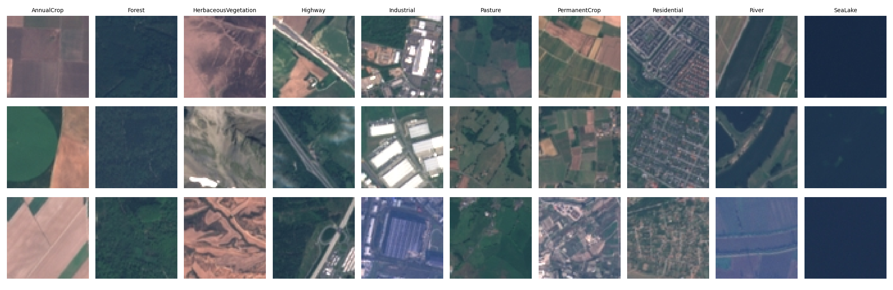
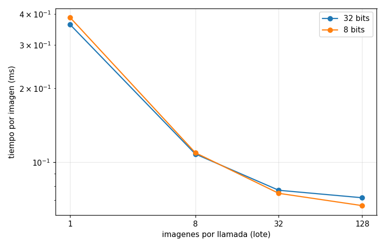
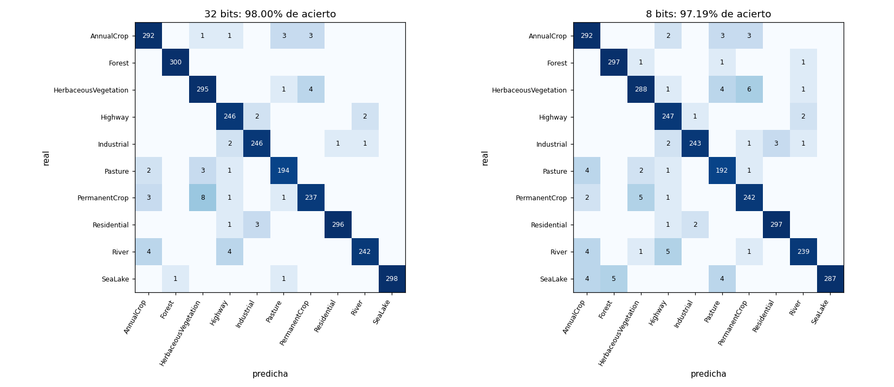

# What does 8-bit quantization cost a satellite image classifier?

On-board AI for Earth observation has to fit in a small, low-power processor. A standard way to
make a network fit is **post-training quantization**: storing weights and activations in 8-bit
integers instead of 32-bit floats. This project measures what that actually costs and gains on a
small satellite image classifier, with **hypotheses written before measuring**.

Pipeline: MobileNetV3-Small fine-tuned on EuroSAT (PyTorch) → converted to OpenVINO → quantized to
INT8 with NNCF → accuracy, size and latency measured on the same held-out test set and CPU.



## Results

Test set of 2,700 images never used for training, model selection or calibration.

| | FP32 | INT8 | Hypothesis (written before) | Outcome |
|---|---|---|---|---|
| **Accuracy** | 98.00 % | 97.19 % | drops to 85-90 % | −0.8 points: networks tolerate rounding far better than expected |
| **Weights on disk** | 6.09 MB | 2.98 MB | 4× smaller (32 → 8 bits) | only **2×**: a third of the weights stay in FP32 |
| **Latency, 1 image** | 0.43 ms | 0.46 ms | much faster | **no gain** at batch size 1 |

### Why the model is only 2× smaller

Inspecting the quantized model: 1.05 M weights are INT8 (1.05 MB) but 0.49 M stay FP32 (1.94 MB).
The FP32 ones belong to MobileNetV3's **squeeze-and-excitation blocks**, small sub-networks that
rescale each channel by a learned factor. NNCF leaves them in floating point by default because
rounding those multiplicative factors hurts accuracy. The 4× hypothesis holds for the weights that
are quantized, not for the model as a whole.

### Why it is not faster, and what is



| Images per call | FP32 | INT8 | INT8 vs FP32 |
|---|---|---|---|
| 1 | 0.363 ms | 0.387 ms | 6 % slower |
| 8 | 0.108 ms | 0.109 ms | equal |
| 32 | 0.077 ms | 0.075 ms | 3 % faster |
| 128 | 0.072 ms | 0.067 ms | 8 % faster |

A 64 × 64 MobileNetV3-Small is so small that the fixed cost of each inference call dominates the
arithmetic, and INT8 adds conversions around the layers left in FP32. INT8 only pulls ahead as more
work is packed into each call, and only slightly. **Batching gives 5× more per image than
quantization does** on this model and CPU. The broader lesson: compression has to be measured on the
target hardware, because the theoretical gains do not always show up.

### Where accuracy is lost



- 48 of 2,700 test images change prediction after quantization: **34 get worse, 12 get better**.
  These are images close to a decision boundary that rounding pushes one way or the other; the net
  effect is −22.
- **SeaLake loses the most** (99.3 % → 95.7 %), confused with Forest (5), AnnualCrop (4) and Pasture
  (4). A plausible but **untested** explanation: water and forest are the darkest, most uniform
  classes, and with activation ranges calibrated across very bright scenes they get fewer of the
  256 levels.
- The most frequent confusion, **HerbaceousVegetation ↔ PermanentCrop**, is not caused by
  quantization: it is already the main confusion in FP32 (12 errors in FP32, 11 in INT8).

## Method

- **Data:** EuroSAT RGB (Sentinel-2, 27,000 images of 64 × 64 px, 10 land-cover classes), split
  80/10/10 stratified by class with a fixed seed; the split is saved in `particion.json`.
- **Training:** MobileNetV3-Small pretrained on ImageNet, last layer replaced (1,000 → 10 classes),
  whole network fine-tuned for 10 epochs (AdamW, cosine schedule), with flips and 90° rotations as
  augmentation (satellite images have no "up"). Best epoch by validation accuracy: 97.85 %.
- **Quantization:** NNCF post-training quantization, calibrated on 300 images from the **training**
  set.
- **Latency:** OpenVINO on CPU (Intel Core i5-13400), 50 warm-up runs, median of 1,000 runs.

Versions: PyTorch 2.11, OpenVINO 2026.4, NNCF 3.4.

## Running it

```bash
pip install torch torchvision openvino nncf matplotlib
python paso1_datos.py           # download EuroSAT, fixed split, example figure
python paso2_entrenar.py        # fine-tune MobileNetV3-Small (GPU recommended, a few minutes)
python paso3_openvino_fp32.py   # convert to OpenVINO and measure the FP32 baseline
python paso4_cuantizar_int8.py  # quantize to INT8 and measure the same
python paso5_analisis.py        # per-class analysis and latency vs batch size
```

## Limitations

- RGB, 64 × 64 crops already processed into a benchmark: not the raw multispectral data a
  satellite actually captures.
- Measured on a desktop CPU, not on a space-grade or edge accelerator, where INT8 support and
  call overhead are very different.
- One training run and one calibration set; the 0.8-point drop has no confidence interval.
- Squeeze-and-excitation blocks were left as NNCF chose. Forcing them to INT8 and measuring the
  accuracy cost would be the natural next experiment.

Code comments are in Spanish.

## License

MIT
